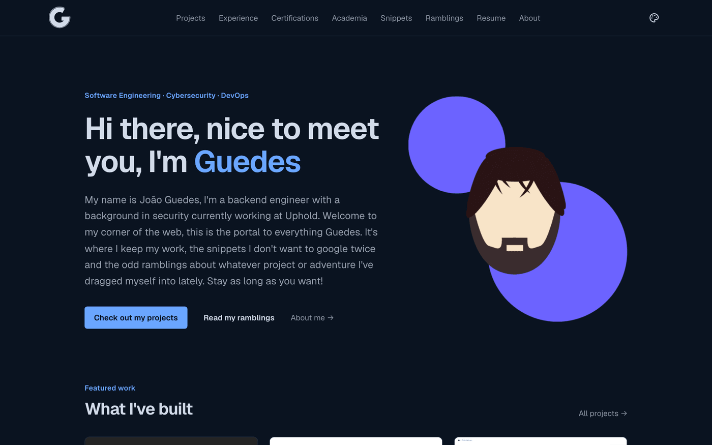
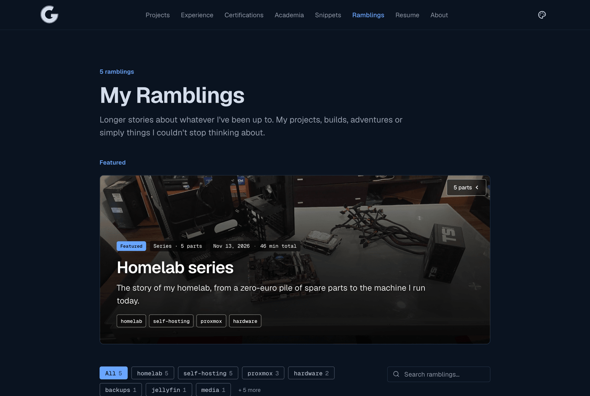
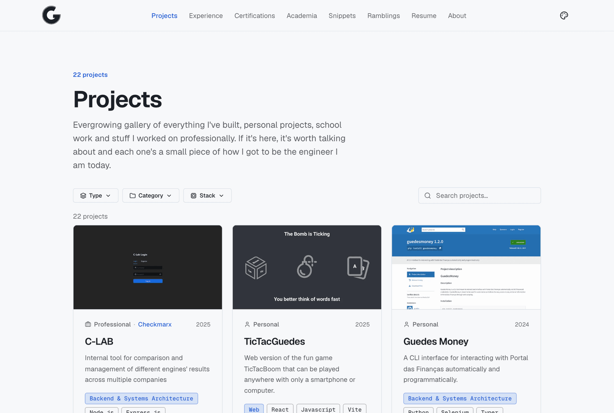

<div align="center">


# João Guedes

**Personal website and portfolio.** My Projects, professional experience, notes and snippets, my blog and CV generator from simple markdown

[Live site](https://joaoguedes.net) · [Changelog](https://joaoguedes.net/changelog) · [Documentation](how_to_use.md)

    

<br />



</div>

## About

The repo is the source of [joaoguedes.net](https://joaoguedes.net), my personal website.

It is a static content-based application built with Astro. Everything on it comes from markdown files in `src/content`
and a few small data files in `src/data`; lists, filters, search and the PDF CV are generated from
those at build time.

I built it to have one place for everything I make and write and to stop rewriting my CV over and over again.
<table>
  <tr>
    <td width="50%"></td>
    <td width="50%"></td>
  </tr>
  <tr>
    <td align="center"><sub>My ramblings, with a featured series</sub></td>
    <td align="center"><sub>My projects, in the light theme</sub></td>
  </tr>
</table>

## What it does

- Projects, blog posts, snippets, roles, certifications and papers are markdown files with a typed schema.
- The resume page and a one-page PDF CV are generated from the same data to facilitate iterations and updates.
- The blog has topic filters, search, multi-part series and a featured block.
- Snippets are organised in nested groups by folder, with a tag filter.
- There are eight themes and seven typefaces, chosen at runtime.
- Callouts, image galleries with a lightbox and a table of contents work in any markdown body.
- `npm run new` scaffolds a content file for any collection.
- The output is static. A few small scripts handle the interactive parts, and there is no client-side framework.
- An RSS feed and a sitemap are generated on build.

## Stack

- [Astro](https://astro.build) 7 with MDX and content collections
- [Tailwind CSS](https://tailwindcss.com) 4 and [daisyUI](https://daisyui.com) 5 for styling and themes
- [pdfkit](https://pdfkit.org) to build the CV PDF during the build
- Hosted on Cloudflare Pages, deployed from GitHub Actions, versioned with
  [release-please](https://github.com/googleapis/release-please)

## Running it locally

Node 24 is required (see `.nvmrc`).

```bash
npm install
npm run dev        # http://localhost:4321
```

Other commands:

```bash
npm run build      # static site in ./dist
npm run preview    # serve the production build
npm run check      # type and template diagnostics
npm run new -- blog "Post title"   # scaffold a content file; -h lists the types
```

## Layout

```
src/content/      markdown for projects, blog, snippets, experience, certifications, papers
src/data/         hand-edited data like site, profile, education, resume, series, CV source
src/pages/        routes
src/components/   Astro components
src/styles/       global.css (Tailwind, daisyUI themes)
src/utils/        build-time helpers (CV generator, changelog parser, series, reading time)
scripts/          the content generator
public/           static files served as they are
docs/             screenshots and design notes
```

## Documentation

- [how_to_use.md](how_to_use.md): adding content, frontmatter for each collection, and how the
  generated pages work.
- [commit_guide.md](commit_guide.md): commit message format and how releases are made.

## Deployment

Pushing to `main` does not deploy. release-please keeps a release pull request open, and publishing
that release runs the deploy workflow, which uploads `dist` to Cloudflare Pages. Pull requests
against `main` get a preview deployment. Details are in [commit_guide.md](commit_guide.md).

## Credits

Icons come from [Lucide](https://lucide.dev) and [Simple Icons](https://simpleicons.org). The typefaces
are Geist, Manrope, IBM Plex, Inter, Space Grotesk and JetBrains Mono, all open source and served
from this repository.

## License

[MIT](LICENSE). You are welcome to use this as the starting point for your own site. If you do,
please keep a visible credit linking back to this repository, for example in your footer or README.

<div align="center">
<sub>Made by João Guedes</sub>
</div>
