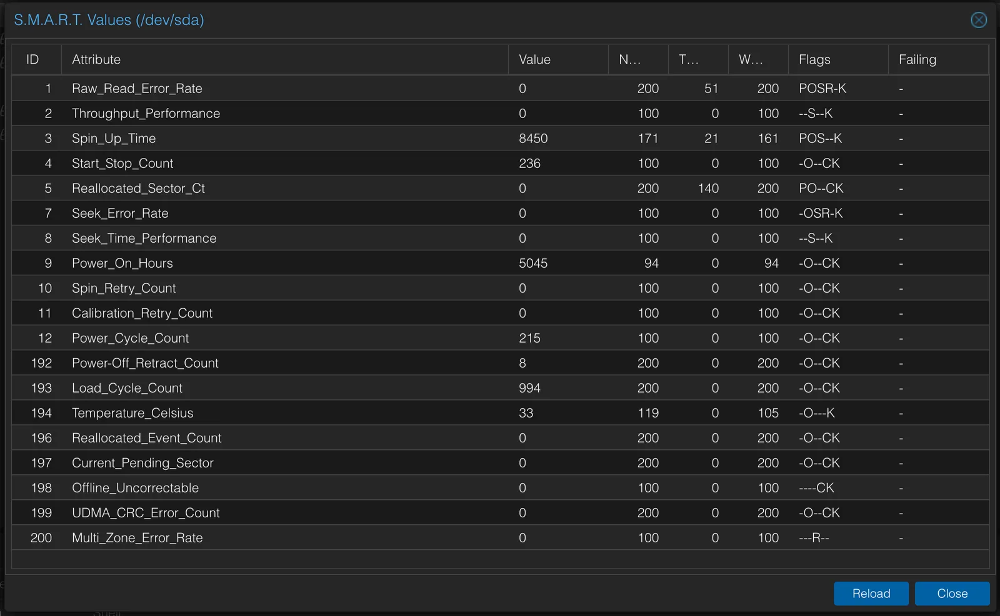
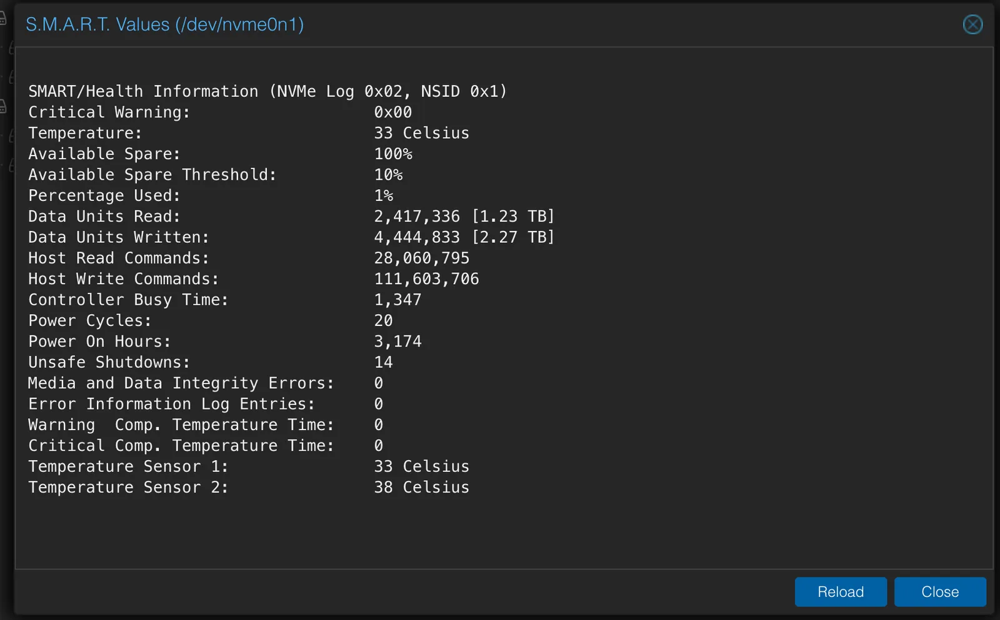
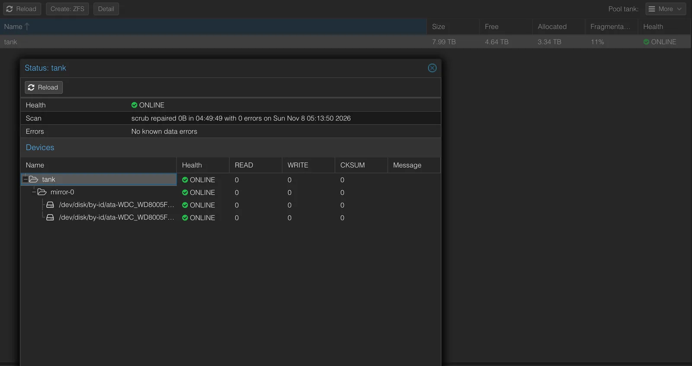
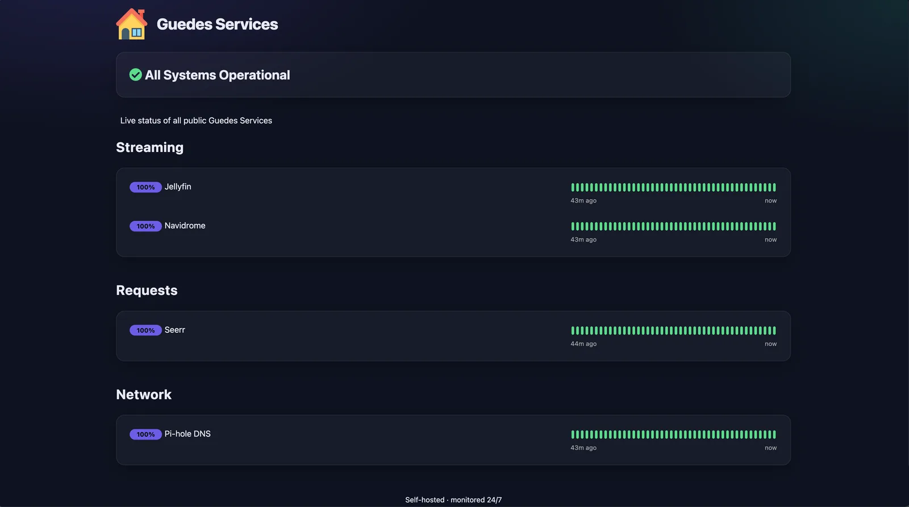
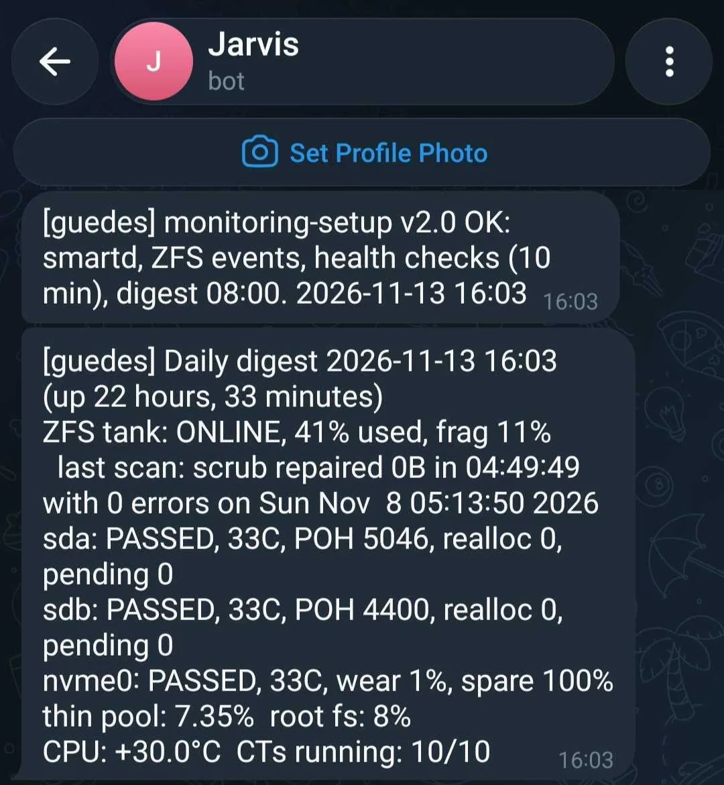
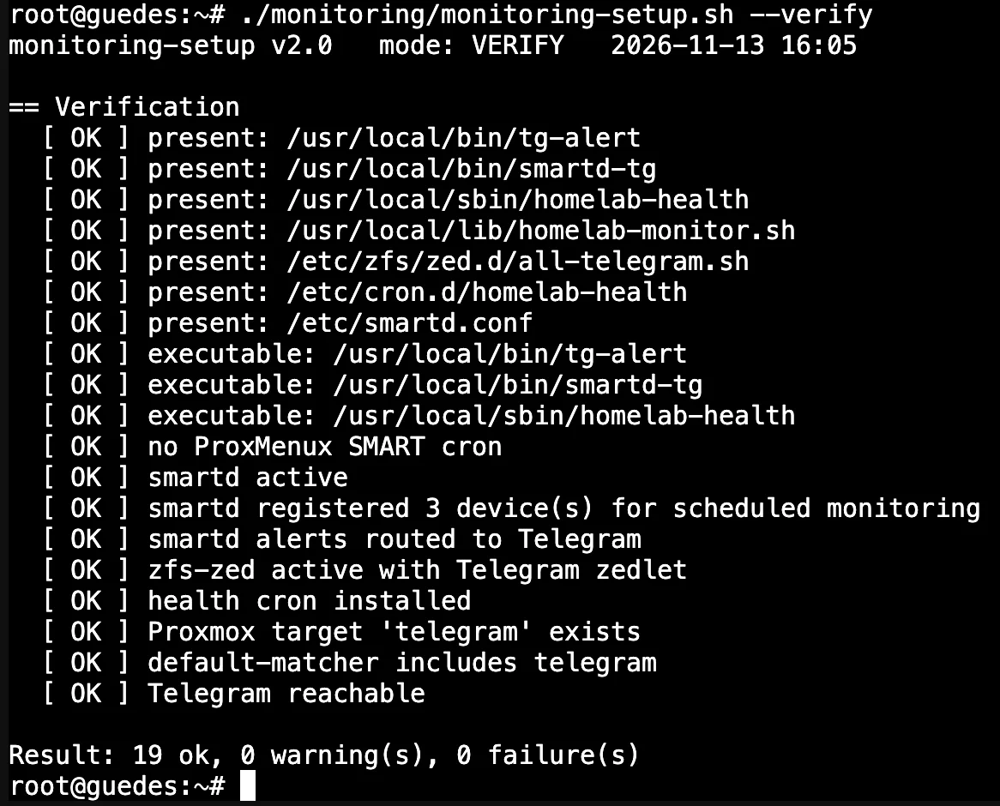

Everything so far was about building things. This last part is about the boring work that makes them last: backups, monitoring and updates.

None of it is exciting until the day it saves you. And that day always comes.

## The best second life for the Frankenlab

When I took the [Frankenlab](/blog/the-frankenlab) apart, I didn't throw the parts away. Instead it became my **Proxmox Backup Server** (PBS), and I think it's the best job it could have had. A backup server doesn't need to be fast, it just needs to be reliable and separate from what it protects. The components I had lying around were more than enough for the job.

It's a pretty small setup:

- **The system** runs on one of the old 500 GB drives, as it did in the Frankenlab.
- **The backups** go to a brand-new 1 TB disk, bought specifically for the backup job.

The first rule of backups is that they can't live on the thing they protect. A second physical machine means a dead disk, a bad update or a mistake in the main lab doesn't take the backups with it.

:::note[Why Proxmox Backup Server]
PBS is built specifically for Proxmox, so there's almost nothing to set up. It does **incremental** backups, which means only the parts that changed since the last run get copied, and it **deduplicates** them, so identical data is stored only once. After the first full backup, new ones are very small and fast.
:::

## What gets backed up

I back up the **whole lab at the Proxmox level**: every container, with its configuration and disk. If the main machine dies, I can restore the containers onto new hardware and be back up quickly, with every service just as I left it.

The data is different. I only back up what I can't get back because storage is the real constraint here:

- **Backed up:** the things that are mine alone, like my photos, home videos, my own files and application configuration, which is small and cheap to back up.
- **Not backed up:** movies, shows and most of the music. They're the bulk of my storage, and they can be downloaded or ripped again. It would take a long time, but I'd lose nothing that can't be replaced. Backing up the media I already have, over 3 TB, would also eat a lot of storage, and that's not what this lab is for. If I lost it, I'd rip it again from my own discs.

That decision is why a single 1 TB disk is enough. Backing up a library you can rebuild would cost me a lot of disk for very little protection.

:::tip[Ask yourself what data is truly important]
Go through your storage and ask of each folder: *if this vanished tomorrow, could I get it back?* Anything you can doesn't need a real backup. Spend your valuable backup space on what's left. Photos are the classic example, which is why [Immich](/blog/the-infrastructure) only goes live once my backups are sorted.
:::

## Backups and the 3-2-1 rule

A mirror, which I covered in [part 2](/blog/the-rebuild), protects me from a dead drive. A backup protects me from everything else: a deleted file, a bad update, a corrupted database.

The usual rule of thumb is **3-2-1**: three copies of your data, on two different kinds of storage, with one of them off-site. Right now I have the live data and a backup on a second machine. A copy off-site is the next step. It doesn't need to be big, since only the irreplaceable data has to go.

### Schedule

As of now I run backups weekly, which means that in the worst case I lose up to a week of changes. Since PBS is incremental, running them every night costs very little extra, so a nightly schedule would be a better fit and I'm thinking of moving to it.

:::warning[Check your backups]
The next worst thing to a missing backup is one that doesn't work when you need it. PBS can **verify** its backups on a schedule, re-reading them to check nothing has rotted, and I recommend turning this feature on. Every so often, restore a container somewhere to check that the whole path still works if you need it.
:::

## Watching the disks

Disks fail, and they usually start displaying some warnings first. Every drive keeps a health report about itself called **SMART**: reallocated sectors, pending sectors, temperature, error counts and so on. The trick is to read it on a schedule, without having to remember.

On my main host, a small service called `smartd` does it. A **quick test** runs every Sunday early in the morning and a **long surface scan** runs once a month. The long scans are staggered, so the drives never scan at the same time.

*One of the data drives. The lines I watch are reallocated sectors, pending sectors, offline uncorrectable and the CRC error count, which should all be zero.*

NVMe drives report a different set of numbers. The ones that matter are the temperature, **Percentage Used**, which is how much of the drive's rated write life is gone, and **Available Spare**.

*The system NVMe: 1% worn after several months, with its spare capacity untouched.*

The Proxmox interface shows these numbers for the moment you open it. It doesn't keep a history, so I let a daily message from my monitoring tell me when something starts to drift. More on that below.

On the media pool, ZFS keeps its own watch. A monthly **scrub** reads every block and repairs anything corrupted from the other half of the mirror.

*The pool's status: both halves of the mirror online and the last scrub clean.*

Two habits are worth having:

- **Run a short test often and a long one less often.** The quick test catches sudden problems and the long surface scan catches the slow ones. Weekly and monthly is a good rhythm, and a daily quick test is cheap if you want to tighten it.
- **Get told when something's wrong.** A health check you don't read is useless, so make sure a warning reaches your phone. Mine arrive on Telegram.

## Monitoring

I don't run a heavy monitoring stack, and I don't think a lab like mine needs one, at least for now. I have three monitoring layers that report back to me through my Telegram bot **Jarvis**.

| Layer | Purpose |
| --- | --- |
| Uptime Kuma | Are the **services** up? |
| Host health script | Is my **machine** healthy? |
| Heartbeats | Is the **monitoring itself** still running? |

Proxmox's own graphs are still the first place I look when something feels slow, and ProxMenux helps with routine host maintenance. I let `smartd` own the SMART schedule, so two tools never run the same tests.

### Uptime Kuma

Uptime Kuma checks every service once a minute and retries twice before it believes something is down. It uses the check that fits each service: a ping for a machine, a health endpoint for a web app, an open-port test for something with no web page, and a real DNS lookup through Pi-hole to prove that name resolution works, not just that the container is up. If any of these checks fail I'll get a notification through Jarvis.

Kuma can also publish **status pages**, and I use two. The **public** one shows only the handful of services other people use, in three groups: Streaming, Requests and Network. The **internal** one shows everything and is reachable only from inside the house. Each page lists its monitors by name, so nothing appears publicly by accident.

*The public status page. If something here goes red, someone else is probably about to tell me.*

### The host health script

Uptime Kuma can tell me a service is down but it can't tell me a disk is slowly dying, a pool is getting full or a scrub has been skipped. For that I have one script, run on the Proxmox host, that sets everything up in one go:

- **`smartd`** is configured from the live list of disks, with the quick and long tests described above, and its alerts go to Telegram.
- **A ZFS event hook** forwards the events that matter, like scrubs starting and finishing, state changes and I/O failures.
- **A health check every 10 minutes** looks at the things in the table below.
- **A daily digest at 08:00** sends one summary message, so I see the lab's vitals every day.
- **A Proxmox notification target** sends Proxmox's own notifications, such as a failed backup job, to the same bot through a webhook.

| Area | What it watches |
| --- | --- |
| ZFS | Pool health, capacity above 85%, and a scrub that's too old or never ran |
| SATA disks | SMART health, reallocated, pending and uncorrectable sectors, cable errors, temperature |
| NVMe | Critical warnings, wear, spare capacity, temperature |
| Host | CPU temperature, full thin pool or root filesystem, swap, low memory |
| Services | Containers that aren't running, failed system services, `smartd` or the ZFS event service not running |

The health check is built not to nag. It tells me **once** when a problem appears, reminds me **every 24 hours** while it's still broken and tells me when it **recovers**.

*The daily digest. Everything I'd want to know on a good day.*

### Who watches the watchmen?

A monitor is great for watching over the lab, but if the monitor itself stopped, how would I know? So three of the Kuma monitors work the other way round, as **heartbeats**. The health check pings Kuma every 10 minutes, the digest pings it daily and a clean ZFS scrub pings it monthly. If a ping doesn't arrive on time, Kuma alerts me.

That covers the script dying, but it has the same limit as everything else here because Kuma runs inside the lab. It watches my **apps** and the health of the machine, not whether the whole lab is up. Watching the lab from the outside needs a monitor that lives *outside* it. If the monitoring runs on the machine it monitors, a full crash takes it down as well and nobody gets an alert. Moving it out is a step I want to take once the more important things are done.

### Setting it up, and setting it up again

The scripts are what let me rebuild all of this without remembering how. The Telegram token never goes on a command line: the host script reads it from a protected file and the Kuma script takes it from the environment. All three scripts **do nothing unless told to**:

- **The host script** runs a **dry run** by default. It checks the system, the Telegram bot and its generated files, shows its plan and says READY or NOT READY. Adding `--apply` backs up the old setup, installs the new one, verifies it and **rolls back** if anything fails. Re-running it at any time recreates the same setup, `--verify` checks an existing install and `--uninstall` removes everything it added.
- **The Kuma script** also dry-runs first, then creates the Telegram notification, the monitors and the heartbeat monitors, and prints the heartbeat addresses to put in the host script's settings.
- **The status page script** creates the two pages from lists of monitor names.

*`--verify`: every file, service and connection checked, 19 OK and 0 failures.*

:::tip[Write down what your scripts do]
If you automate something, put the *why* next to it. A year from now, "what does this script do and what happens if I run it twice?" should have an answer you wrote down. I wrote it here, in the post, for exactly that reason.
:::

## Updates

I update everything **by hand**, and I read what a new version changes first. It's slower than automatic updates, but I know what's running and I've never been surprised by an overnight change.

It does have a cost: I have to remember to do it. The risk of falling behind is very real, since an old version of a public service is an easy way of letting a vulnerability slip by.

So I see this as the thing I most want to improve. I'd still vet every update myself, but I'd automate everything around that:

- **Notifications of new versions**, so I'm told rather than needing to remember to look.
- **A snapshot or fresh backup before every update**, which makes rolling back a few clicks. Proxmox makes this easy.
- **Updating the most exposed services first**, which are the few that are reachable from the internet.

:::tip[Never update without a way back]
Before touching anything important, take a snapshot. If the update goes wrong, rolling back takes a minute.
:::

## Main takeaways

- **Give your old hardware a second life as a backup server.**
- **Decide what's irreplaceable** and back up only that.
- **Back up often.** If your backups are incremental, daily costs almost nothing.
- **Verify and restore.** If you never tried restoring you're just hoping that it works when you need it.
- **Have an off-site copy** of the data you can't live without.
- **Get told when something breaks.** Monitoring that you don't see is useless.
- **Update your software often but responsibly.**
- **Snapshot before every update.**

## The end of the beginning

It started with a cost-free machine built from leftovers and me getting my feet wet in this beast of a hobby. It ends with a quiet, capable and efficient box in my study, in a case that blends in and isn't an eyesore. It runs the whole house's media, names, logins and passwords, and it's backed up to the hardware that started it all.

The best part is how many people use it now. A lab is never really finished, though, and there's a list of apps I want to try next. I'll write about them when they're running. For now this is everything. Happy labbing!