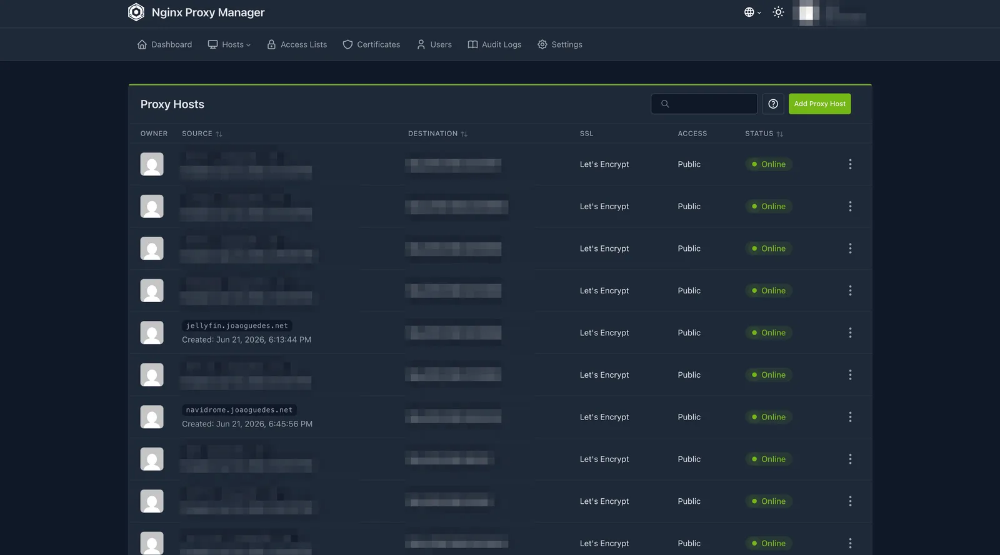
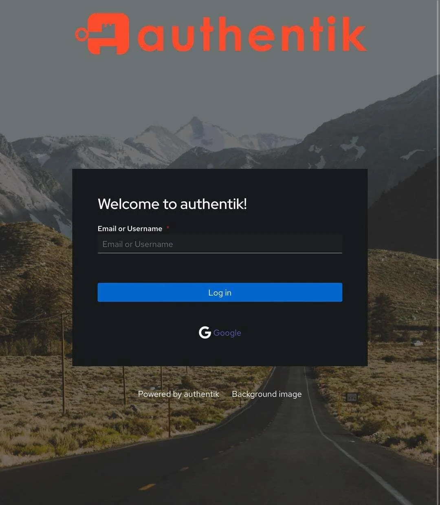
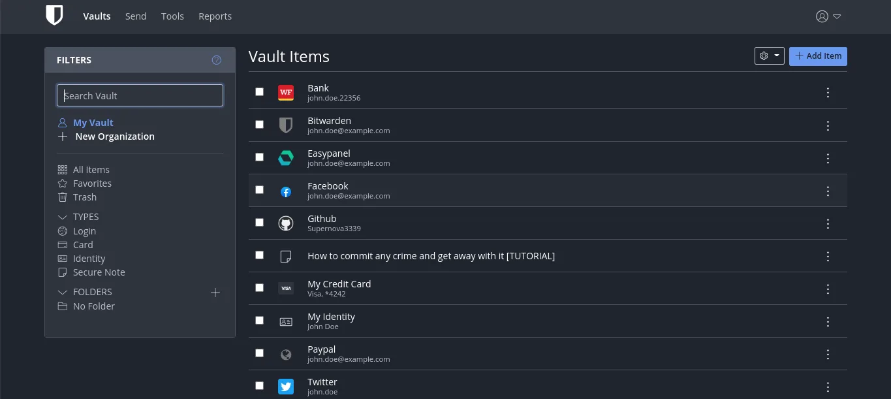
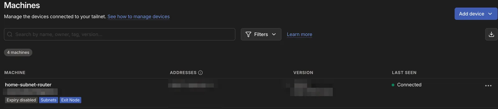
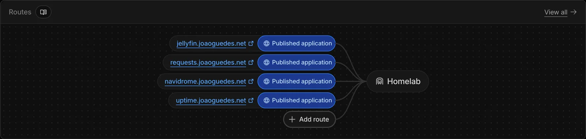

A cool service you can't reach safely, or can't remember the address of, may as well not exist. Parts 2 and 3 covered the machine and the apps. This part is about how to properly host them, how domain names get resolved, how traffic is encrypted, how I log in, where my passwords live and how I reach my LAN when I'm not home.

It's the least glamorous part of the lab but it was one of the most exciting parts for me as I love networking and infrastructure.

## DNS and caching

In the [Frankenlab](/blog/the-frankenlab) a tiny dnsmasq VM answered DNS for the house. Now it's Pi-hole in its own container, paired with Unbound.

**Pi-hole** is mainly my local DNS server: any device on the network that asks for one of my local domains (`jellyfin.joaoguedes.net`, `requests.joaoguedes.net`, `navidrome.joaoguedes.net`, `uptime.joaoguedes.net` and so on) gets the reverse proxy's address back. It's also an excellent ad blocker, as it refuses to answer for ad and tracker domains, so a lot of ad junk never loads. It works through blocklists and the default ones are so good that I haven't changed them yet.

**Unbound** is the part you don't notice. Most setups forward every DNS question to a public resolver, which then sees every site you visit. Unbound is a *recursive* resolver: it asks the internet's root servers directly and works its way down, so no single company sees all my queries. It validates DNSSEC signatures and caches answers, so repeat lookups are instant.

The two work as a pair. Devices ask Pi-hole, Pi-hole blocks what it should and passes the rest to Unbound. Together they're the foundation of my home network's name resolution.

You can point each client at any DNS server you want, but you'd have to do it once per device. Instead, point your router at your DNS server and every client on the LAN uses it automatically. That's what I did: my router hands out Pi-hole as the DNS server.

### When DNS goes down

Putting all your DNS on one machine has a catch: when the lab is down, so is name resolution for the whole house, and "the internet is broken" is a very unpopular bug report. Plan for it before it happens:

- **Decide what the fallback is.** A public secondary DNS keeps the internet working while the lab is down, at the cost of ad blocking and local names until it's back. That's a trade-off, so decide on purpose.
- **Know how to reach things without DNS.** Keep the addresses of your key services written down somewhere that isn't on the lab.
- **Keep DNS in its own container.** It's tiny, it boots in seconds, and it should come back before everything else.

:::tip[Check DNS first]
When something is down, it's very often DNS. Before digging into a service, check that its domain name still resolves.
:::

## Names and certificates

Nobody wants to remember `192.168.x.x:8989`. Each service gets a proper name under my own domain, and a reverse proxy, Nginx, sits in front and sends each name to the right container.

It also handles HTTPS. I have a single **wildcard certificate** from Let's Encrypt that covers every subdomain, so adding a new service means adding a name, not requesting a new certificate. Every site is forced onto HTTPS, with HSTS on, which tells browsers to never even try the plain HTTP version.

That means every app is encrypted from the browser to the proxy.

*The reverse proxy's host list. One row per service, all on HTTPS. Most of it is blurred on purpose.*

## One login for everything

By the time you have a dozen apps, you have a dozen login credentials. **Authentik** is my fix: a single identity provider that other apps trust, so I log in once and every connected app knows who I am.

I drew the line by audience. Everything behind Authentik is a **management app**, the kind only I should ever touch. Everything that other people use keeps its own login, because family and friends shouldn't need to understand my identity setup to watch a movie.

Single sign-on gives you three things:

- **Only one account to look after**, instead of a dozen passwords to remember or reuse.
- **MFA in one place.** You set it up once and it covers every connected app.
- **One off-switch.** If an account needs to be locked, you do it in one place.

*Authentik's login page.*

## A vault of my own

For passwords I run **Vaultwarden**, a lightweight server that implements the same protocol as Bitwarden, so the official apps and browser extensions work perfectly with it. This way my vault lives on my own hardware.

*An example vault in the web interface, which looks the same in Vaultwarden. Not my real one.*

## Remote access

I want two things from remote access in my lab. One is to reach my home LAN remotely, the other is to expose as little as possible to the internet. I use three tools for this, each for a different job.

**A VPN for me.** When I'm away, I connect to my home network as if I were sitting in it. There are two ways in at the moment:

- **Tailscale** runs in its own small container as a *subnet router*. One node on the network advertises my whole home network to the tailnet, so my phone and laptop can reach every device without installing anything on them.
- **Teleport**, built into my UniFi router, does much the same job with one tap in the app. It's newer here and I'm still testing it, but it may end up replacing Tailscale for me.

*The subnet router in Tailscale. Addresses blurred.*

**A tunnel for the few things I share.** For the handful of services that are meant to be public and other people use, I use a Cloudflare Tunnel. A small connector inside the house makes an *outbound* connection to Cloudflare, and visitors reach my service through that. Nothing needs to listen for strangers on my home connection, which is the big difference from the Frankenlab, where I forwarded ports straight to a reverse proxy.

*The tunnel and its four published routes.*

:::note[Share less than you think]
The best protection for a service is not to expose it. Sensitive things that only I use belong on my LAN only. Only the things other people really need should be reachable from the internet, and always behind an account. Those apps sit behind the Cloudflare proxy, but they still need updating as soon as new versions are available. You never know when a vulnerability will hit.
:::

## Sharing it was the best part

The thing that made all of this worth it wasn't a technical win. It was sharing the lab with my girlfriend. She has her own account, requests her own shows and uses it constantly. A few friends and family members did the same, and they all love it.

That's what the DNS, the certificates and the access rules are really for. Done well, nobody notices them. Someone just opens a name in their browser, logs in and finds what they wanted.

## What's next for the lab

With the foundations in place, adding a service is now cheap: a container, a name, a certificate and, if it's a management app, a login through Authentik. Here's what I want to run next:

- **Mealie** for recipes. I loved it in the Frankenlab and I miss it.
- **Paperless-ngx** for documents. It scans, reads and tags every paper that lands on my desk, so I can find any of them with a search. I tried it in the Frankenlab and liked it a lot.
- **Immich** for photos. A self-hosted alternative to Google Photos, with face and object search. Photos can't be replaced, so this one only goes live once its backups are sorted. More on that in the next part.
- **Komga** for comics and ebooks. Another Frankenlab veteran.
- **Karakeep or Linkwarden** for saving links and pages with tags and full-text search, so I stop losing the things I read. I haven't picked between them yet.

## Main takeaways

- **Run your own DNS.** It gives you ad blocking, privacy and local DNS.
- **Use a wildcard certificate** and a reverse proxy, so new services are easy to set up.
- **Set up single sign-on early.** It's far easier than retrofitting it.
- **Prefer a VPN or a tunnel over forwarded ports.**

All of this makes the lab very convenient but does not help if the disks die or files are lost. In the final part I'll cover how I keep it alive: backups, monitoring and updates.