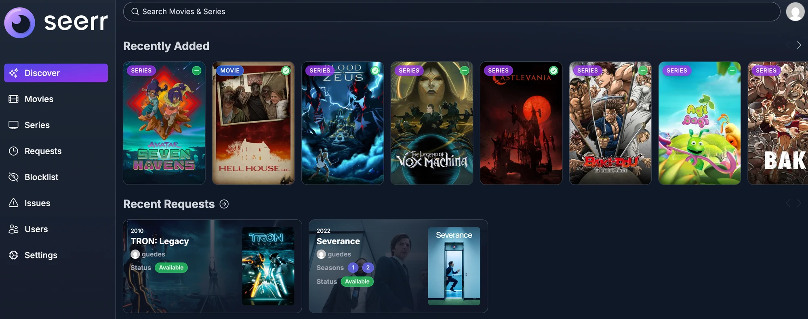
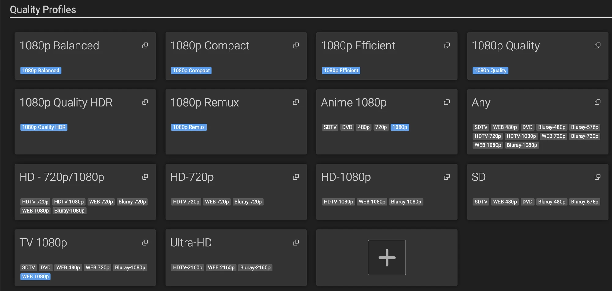
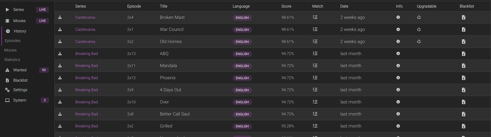
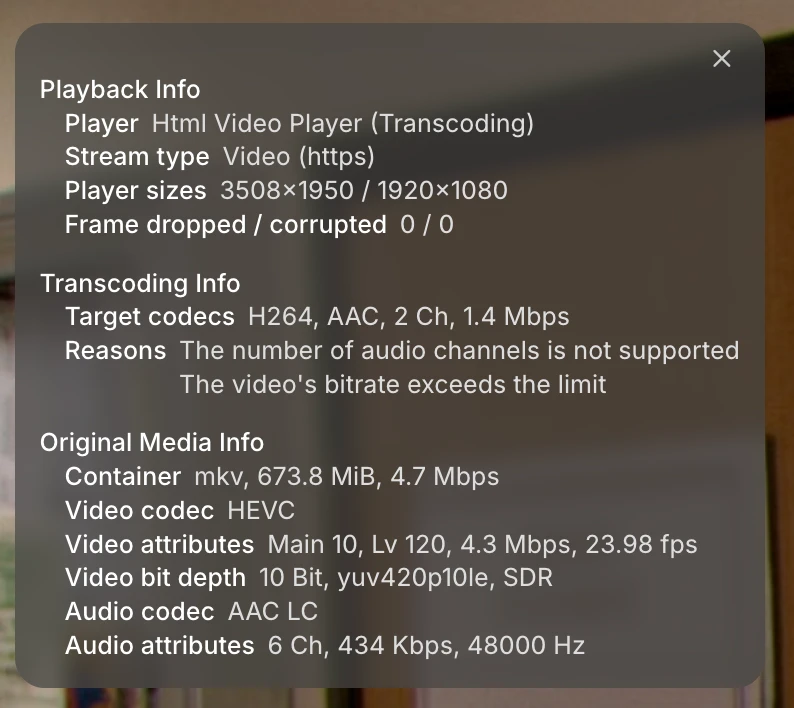
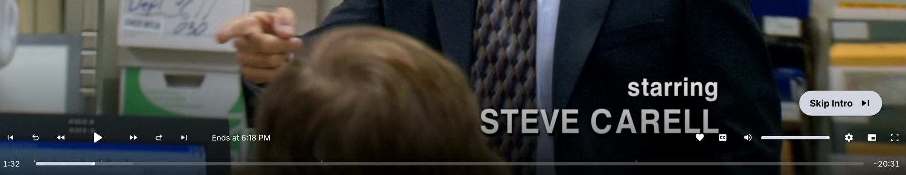
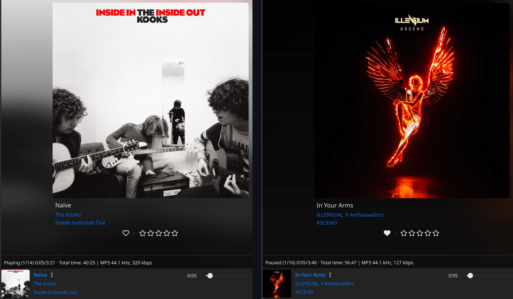

Media streaming is the most common reason people get into self-hosting. I didn't care much about it at first, until I tried it. Then I couldn't get enough. You own your media, and whatever happens to Netflix, Disney+ or Hulu, it stays exactly the way you left it.

Nowadays my library stays the same for a few weeks, and then I go on a collection spree and grab enough new things to watch for the next few months. I get them in a few ways: buying from legal distributors, Usenet, and good old DVD ripping, then compressing it all to add to the library.

You can add media to Jellyfin by hand, but the end goal for most labs is to automate as much as possible. The ideal flow would be somebody in the house wants to watch a movie, they ask for it, and a few minutes later it's in the library paired with subtitles, in the quality I'd have picked myself.

This is part 3 of a five-part series. [Part 2](/blog/the-rebuild) kept the software light on purpose. This one goes deep into the apps, and how I configure them.

## The journey of a request

Everything in this stack exists to fulfill this happy path:

1. **Someone asks for a title** in Seerr, which they log into with their Jellyfin account.
2. **Seerr hands the request to Radarr or Sonarr**, depending on whether it's a movie or a show.
3. **Radarr or Sonarr search the indexers**, which Prowlarr manages in one place, and pick the best release according to my quality rules.
4. **A download client fetches it**, into a downloads folder.
5. **The finished file is imported into the library**, renamed and filed properly.
6. **Bazarr finds subtitles.**
7. **Jellyfin sees the new file** and it appears in the library.



*Seerr is the only screen my family ever sees. Requests that are already fulfilled show up as "Available".*

:::note[Indexers don't always mean torrents]
An indexer is just a searchable catalogue of releases. It says nothing about *how* the files get to you. I rarely torrent. Most of my library comes from legal distributors, from Usenet (which has its own indexers and its own downloader) and from ripping and compressing my own discs. Prowlarr and the download client don't care which one is behind a request, and the rest of the stack works exactly the same.
:::

Each app does exactly one job, and they communicate over their REST APIs to trigger processes and perform actions.

| App | Its one job |
| --- | --- |
| Seerr | The requests page |
| Radarr | Movie manager |
| Sonarr | Shows and anime episodes and seasons manager |
| Prowlarr | Keeps the list of indexers and syncs it to the other apps |
| Download client | Fetches the files |
| Bazarr | Subtitles manager |
| Jellyfin | Media streaming service |

All of these run as containers, grouped into Docker Compose stacks, all sharing the same directory layout.

## Directories

If I could give one piece of advice about this stack, it's that you should decide your directory layout first, and keep everything on the same filesystem. These apps work by dropping files into known directories.

```
/media
├── downloads/   ← where downloads land
│   ├── movies/
│   └── tv/
├── movies/      ← the Radarr library
├── tv/          ← the Sonarr library
└── music/       ← the Navidrome library
```

Every app that needs to access media has the same `/media` directory available to them. That matters because when Radarr imports a finished movie it creates a **hardlink**. The same data is then visible in two places, the downloads folder and the library, but takes up space only once. The download client can keep sharing its copy while Jellyfin plays the library one, and when I eventually clean up the downloads, the library file stays.

This only works if both paths are on one filesystem. Mount them as different volumes, or put them on different datasets, and the apps will fall back to copying. That's why [the media lives in one ZFS dataset](/blog/the-rebuild).

:::tip[How to tell it's working]
Look at the library and downloads copies of a file with `ls -li`. If both show the same inode number, it's a hardlink. If the numbers differ, you've got two copies.
:::

## Media quality

An automated library is only as good as its rules. This is the part where I started out the hard way.

At first I built my own custom profiles from scratch. It worked okay, but writing and tuning every rule myself was slow, and I never really knew whether I'd covered everything. Then I found **Profilarr**, which clones the community-maintained [TRaSH Guides](https://trash-guides.info/) into profiles Radarr and Sonarr can use directly. It's awesome, and it works very well. Somebody else keeps the base rules up to date, and I only have to look after the small part that's mine.

I still keep a few overrides on top, which is fine. The point is that the foundation isn't mine to maintain.



*Sonarr's profiles page. The 1080p set and the anime profile are the ones Profilarr keeps in sync.*

What I'm optimising for is very simple:

- **1080p, from Blu-ray or a good web release.** My TVs are all 4K, but on them 1080p is almost indistinguishable, and it's far smaller.
- **Movies capped at roughly 8 GB**, with 10 to 15 GB as an absolute ceiling for very odd cases, which hasn't happened yet.
- **Original audio, with English and Portuguese subtitles.**
- **Anime gets its own profile**, still 1080p, but no remux files.

### Season packs

Shows have their own wrinkle. A full season in one download is usually the best release, but Sonarr doesn't handle bundles that span several seasons well. For those I search manually and import by hand. Otherwise, single-season packs are absolutely the way to go.

## Subtitles

Bazarr connects to both Sonarr and Radarr and keeps an eye on what's in the library. It searches several subtitle providers, scores each result on how well it matches the release you have, and only takes it above a minimum score. Mine is stricter for shows and slightly looser for movies. It also keeps checking for a few weeks in case a better one is uploaded later. I don't think about subtitles anymore.



*Bazarr's history: each subtitle it grabbed, with its match score.*

## Jellyfin

Jellyfin is why we do all of this. It's the heart of the streaming side, and it's completely customizable, down to its name. Mine is called "Guedesflix".

### Direct play first

The goal is that Jellyfin never has to work hard. I compress my own media with HandBrake, to H.264 or H.265 on purpose, because those two play natively on nearly every device I own. Together with the quality profiles, that means almost everything **direct plays**. No transcoding means almost no load on the server while streaming.

### Transcoding as the safety net

For the rare client that really can't play a file, the server steps in. I use **Intel Quick Sync** through the container's graphics device, with hardware decoding switched on for the common codecs, including 10-bit HEVC. That puts the load on the iGPU and leaves the CPU free.

To see it in action, I lowered the bitrate limit in the player below what my file needed, which forces a transcoding. The playback info overlay shows what happened and why:



*A transcode I forced on purpose. The overlay lists the original file, the target, and the reasons.*

It works like a charm. It's also the exception, not the rule.

### Plugins

I run a few plugins, for metadata, subtitles (another safety net) and the home page theme. The one I'd really miss is **Intro Skipper**, which adds a button to skip a show's intro. Every now and then it gets confused by an odd episode, but for 99% of what I watch it just works.

The catch is the first scan. It has to analyse your whole library to find where each intro starts and ends, and it stores that as chapters on each file. Depending on the size of your library, that takes anywhere from a few minutes to a few hours. After that, only new or changed files get scanned, so a new episode or season takes a couple of seconds.



*The Skip Intro button.*

## Music is a different beast

Music doesn't fit the same machinery, so it has its own setup. The library lives in Navidrome, which is light, fast and works with any Subsonic compatible application.

Music gets in through two doors:

- **deemix**, for when I just want to listen to a band or a song right now without hunting for the files. It's wonderfully low friction. The catch is that it's limited to 128 kbps, which isn't considered high quality.
- **Soulseek**, for the good stuff. It takes more effort, but I find the high-quality files there. Downloads land in a staging folder until I've tagged them.

### Tags, briefly

Music files carry their own labels, called **tags**: artist, album, title, track number, year and the cover art, all stored inside the file itself (ID3 tags in MP3s, Vorbis comments in FLAC). Navidrome doesn't care what a file is called. It builds the whole library out of the tags, so a track with missing or wrong ones shows up as "Unknown Artist", or ends up split across two copies of the same album.

That's why tagging matters. Files from deemix arrive already tagged, which is a big part of why it's so painless. Files from Soulseek are a mixed bag, because they come from other people's collections with whatever tags they happened to have, or none.

### Tagging Soulseek downloads with Picard

For these I use [MusicBrainz Picard](https://picard.musicbrainz.org/). MusicBrainz is an open database of music: albums, track lists, release dates, cover art. Picard is its official tagging app. I drop a folder of files into it, and it tries to match them to a release in the database, either by comparing the track count, lengths and existing tags, or by fingerprinting the audio itself. When it finds a match, it rewrites the tags properly and fetches the cover art.

My process is a mix of manual and automatic. Most albums match on their own. When the match is ambiguous, like a reissue, a deluxe edition or a compilation, I pick the right release myself, or fix a detail by hand. Picard only ever touches the tags, never the audio, so the quality stays exactly what I downloaded.

When I hit save, Picard writes the tags and moves the files into the library folder, named and organised from those tags. Navidrome notices the new files by itself, and the album simply appears.

### Keeping an eye on quality



*Same player, same library, different sources: 320 kbps on the left, 127 kbps on the right.*

The two together mean I never wait to hear something, but I also never fully trust the library. So I wrote a small script that runs on a schedule and counts how many of my tracks fall below my quality bar. Right now, around 40% of the collection is lower quality than I want.

I really like this flow. Nothing is urgent. When I feel like it, I sit down, pick an album from the list and search for it on Soulseek, where I'll almost always find a 320 kbps or FLAC version. Then I replace the files and it's done.

## Main takeaways

- **Pick the directory layout before the apps.**
- **Describe your desired media quality in a sentence**, then write the profile that matches.
- **Start from the community profiles**, and override only what you need.
- **Give music its own path.** It never fits the multimedia pipeline.

In the next part I'll cover everything that holds this together. The DNS, the reverse proxy, single sign-on, the password manager, and how I manage my lab from outside my LAN.