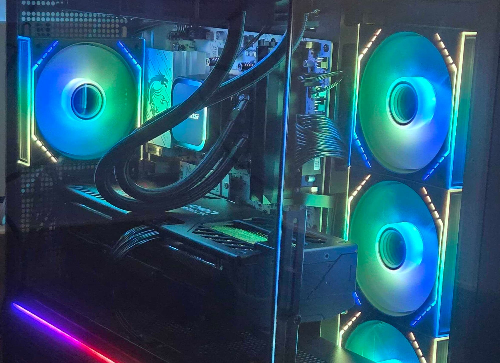
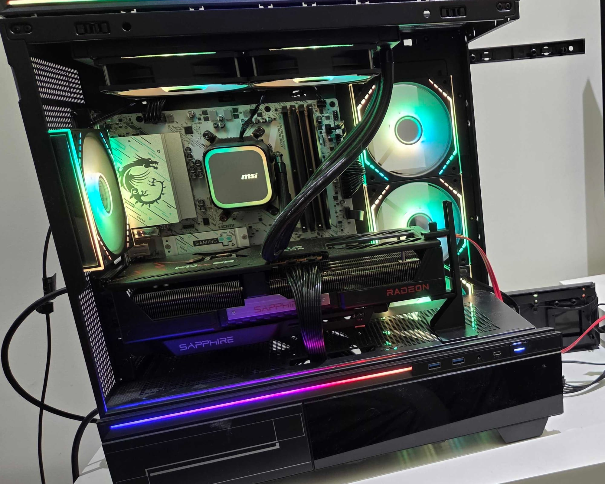
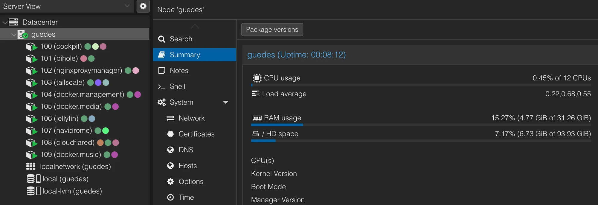

The [Frankenlab](/blog/the-frankenlab) got me hooked. The next question was a more expensive one: *what would I build if I wanted to do it properly?*

This is part 2 of the Homelab series. It covers the hardware upgrades, the storage and the shift from dedicated VMs to light, fast and to-the-point LXC containers.

## The new hardware

When I retired my 8-year-old gaming rig, its CPU, motherboard and RAM became the heart of the new lab. Everything else I bought new, specifically for the lab.

| Part | What I have | Where it came from |
| --- | --- | --- |
| CPU | Intel Core i7-8700K: 6 cores, 12 threads | Old gaming rig |
| Motherboard | MSI Z370-A PRO | Old gaming rig |
| RAM | 32 GB DDR4 (2×16 GB) | Old gaming rig |
| Graphics | The CPU's own Intel UHD 630. No dedicated GPU | |
| System disk | Samsung 990 PRO, 1 TB NVMe | New |
| Data disks | Two 8 TB NAS-grade WD drives, 7200 rpm, mirrored | New |
| Case | Fractal Design Define 7 | New |
| CPU cooler | Thermalright Peerless Assassin | New |
| Case fans | Corsair | New |
| Power supply | Corsair RM750e, 80 Plus Gold | New |
| Network | One gigabit port | |

Compared to the Frankenlab, that's three times the threads, almost three times the RAM, and a mirror of two disks that are each about sixteen times bigger than the drives I had. It's also, honestly, more machine than this workload needs. The CPU sits mostly idle and the RAM is usually less than 15% used. This is perfect because it leaves most of my computing power for future projects and for me to mess around and learn safely without disrupting my live services.

### The case

The Frankenlab lived in a dusty hand-me-down case. This time I wanted something I'd enjoy building in, so I bought a Fractal Design Define 7. It's sleek, it's silent, and it's very builder-friendly, with tons of room for more disks and custom bits. There's a reason it's the gold standard for homelab machines, and building in it was a pleasure.

Cooling is a Thermalright Peerless Assassin on the CPU, and Corsair fans on the case. Between them the 8700K stays super chill, even though it's an 8-year-old chip, and the whole machine stays quiet. This way I can plug it in wherever I want in the house with no complaints, ideally in the study.

Power comes from a Corsair RM750e, 80 Plus Gold rated. After a Frankenlab that survived on a 10-year-old Bronze unit, I wanted a power supply properly suited to a machine that runs all day, every day.

## My new rig

The old rig didn't just donate its parts. Retiring it meant I could finally build its replacement, and since I was buying hardware anyway, I went all in on AMD: a Ryzen 7 9800X3D, a Radeon RX 9070 XT and 32 GB of DDR5. That's a story for another post, but it's part of why this lab exists, so it would be wrong to leave it out.





## Storage

I split the storage by job.

The NVMe drive holds Proxmox itself and the disks of every container. It's fast, and small things like databases and app configs benefit most from speed.

The two big drives are a ZFS mirror I called `tank`. Everything I'd hate to lose lives there: movies, shows, music and home videos. A mirror means each file is stored on both disks, so one drive can die and nothing is lost. It also gives me checksums, so ZFS notices a corrupted file and repairs it from the other copy, and a monthly scrub checks every block.

Creating it took three commands:

```bash
zpool create -o ashift=12 tank mirror <disk-1-id> <disk-2-id>
zfs set compression=lz4 tank
zfs create tank/media
```

:::note[Why one dataset]
I kept all the media in a single dataset on purpose. The media automation downloads a file and then *hardlinks* it into the library, so the same data appears in two places without taking up space twice. Hardlinks only work inside one filesystem, and in ZFS every dataset counts as its own.
:::

:::warning[A mirror is not a backup]
It protects me from a dead drive. It doesn't protect me from deleting something by accident, a bad update, or the house burning down. Backups are a separate problem, and I'll cover mine in a later part.
:::

## Containers instead of virtual machines

In the Frankenlab, everything was a virtual machine. Each one carried its own kernel, its own memory reservation and its own overhead, and on 12 GB of RAM I felt every one of them.

This time everything runs in **LXC containers**. A container shares the host's kernel instead of emulating a whole computer, so it starts in seconds, uses a tiny amount of memory, and lets me give each service its own space without paying for it. I run ten of them, and together they usually use less than 15% of the machine's RAM.

| Role | What it does |
| --- | --- |
| DNS | Pi-hole with its own recursive resolver, so my network blocks ads and doesn't depend on someone else's DNS |
| Reverse proxy | Gives every service a clean name and a proper certificate |
| VPN | Gets me back into the house when I'm away |
| File sharing | Samba, so every computer and phone sees the media as a normal network drive, managed through Cockpit |
| Docker hosts | One for management tools, one for media automation, one for music |
| Media servers | Jellyfin for video, Navidrome for music |
| Tunnel | A lightweight connector for the few things I share outside |



*The Proxmox view: ten containers, and the whole node barely noticing.*

This is a big change from the Frankenlab. The OpenMediaVault VM I used for storage is gone. Now ZFS owns the disks, and a small container shares them over Samba. Fewer layers means fewer things to break.

### Sharing the storage

Every container that needs the media gets the same ZFS folder, mounted as a bind mount:

```bash
pct set <ctid> -mp0 /tank/media,mp=/mnt/media
```

On top of that I made one rule: every media-related service runs as the same user and group ID. It's boring, and it saves a huge amount of pain. No more "permission denied" because the downloader and the media server disagree about who owns a file.

### Privileged or not

Containers come in two kinds. An *unprivileged* container is mapped to a harmless range of user IDs on the host, so even if something inside it goes wrong, it can't do much outside. A *privileged* container runs as real root, which is more convenient, because files and devices just work, and also much riskier.

I started with several privileged containers, because the helper scripts I used to set them up made it easy and shared storage is simpler that way. Later I went back and tightened most of them, giving each one access only to what it really needs. A few are still privileged on purpose, for convenience. That's a trade-off I made knowingly.

:::tip[The scripts that did the heavy lifting]
Most of my containers were created with the community [Proxmox VE Helper-Scripts](https://community-scripts.github.io/ProxmoxVE/). They're a quick way to get a service running, but read what they set up. Some of the defaults are more permissive than you need.
:::

## The i7-8700K is great

Remember the i5 in the Frankenlab, with no hardware support for modern video formats? This is where the new CPU pays off.

The i7-8700K's built-in graphics supports Intel's Quick Sync, which can decode and encode video in hardware, including HEVC. I pass that graphics device through to the Jellyfin container, and when a client can't play a file directly, Jellyfin transcodes it on the iGPU easily. Passing a device into a container is also much simpler than into a VM, which is another point for LXC.

## Main takeaways

- **Split the storage by job.** Fast disk for the system, big mirror for the data.
- **Use containers.** More services, less memory, fewer moving parts.
- **Pick one dataset for media.** It keeps hardlinks and the automation happy.
- **Give everything the same service user ID.** It removes a whole class of problems.

The new machine is much quieter, cheaper to run and more efficient than the Frankenlab. It runs everything much better, faster and with much more headroom to spare for me to expand and/or use for messing around and learn.

I kept the software light on purpose. In the next part I'll go much deeper into the apps and how I configure them: Jellyfin, the automation behind it, and how I decide what quality is good enough.
